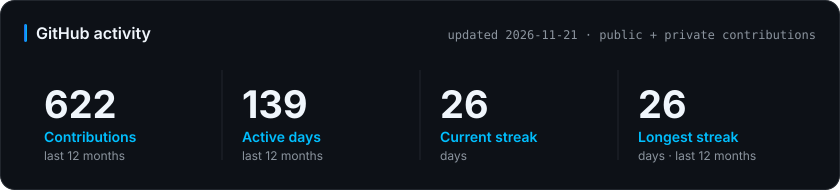
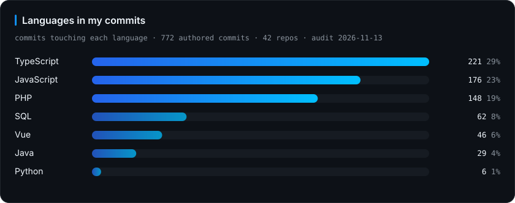
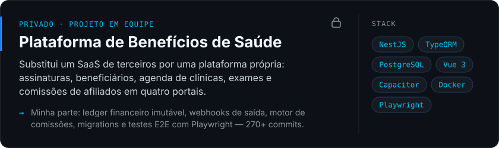
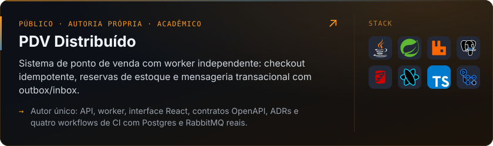
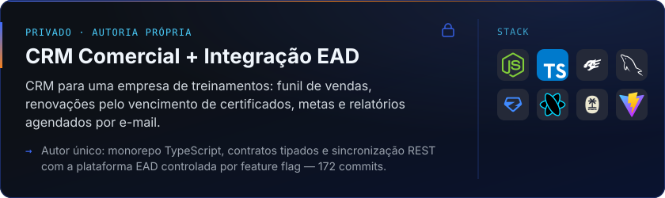
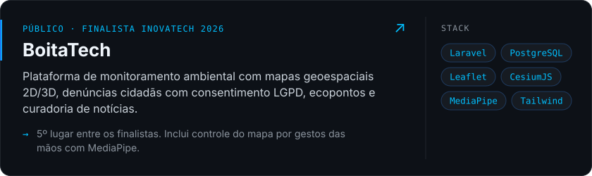
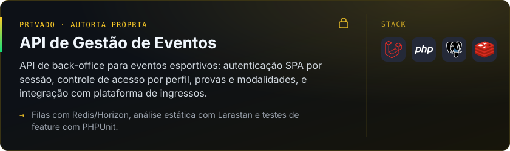
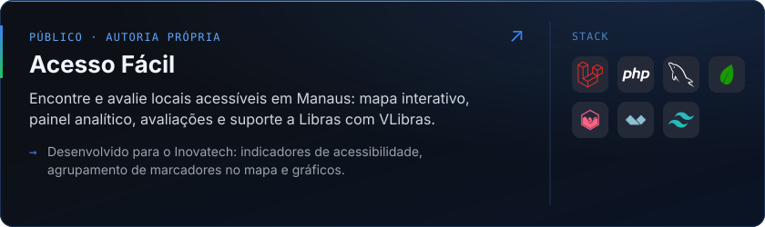
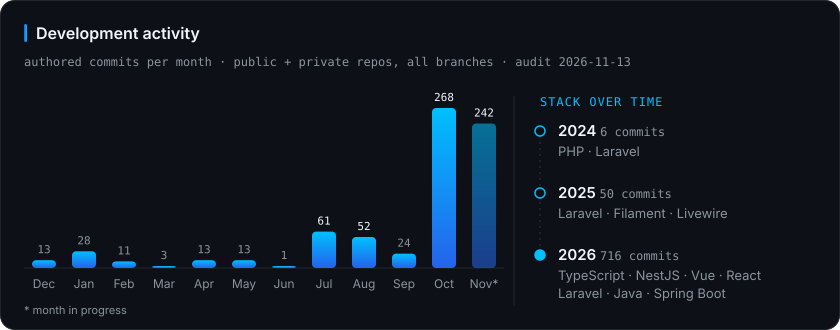

  

  
  &nbsp;
  

 

## About me

I'm a full stack developer based in Manaus, Brazil. Most of my work is web systems built end to end: Laravel and NestJS APIs, Vue and React interfaces, relational data models in PostgreSQL and MySQL, and the tests and CI that keep them shippable.

I care about the parts that make software trustworthy: idempotent operations, versioned migrations, contracts written before code, and decisions recorded as ADRs. I work with AI coding agents (Claude Code) inside a spec → review → CI loop, never as a substitute for it.

|                 |                                                                                              |
| --------------- | -------------------------------------------------------------------------------------------- |
| **Now**         | Contributing to a multi-portal health benefits platform: NestJS, Vue 3, PostgreSQL           |
| **Recently**    | A sales CRM on a typed Fastify + Kysely API, and an event-driven POS in Spring Boot + RabbitMQ |
| **Recognition** | Inovatech 2026 finalist (5th place) with BoitaTech                                           |

 

## Tech stack

| Area | Core | Hands-on |
| :--- | :--- | :--- |
| **Languages** |  |  |
| **Frontend** |  |  |
| **Backend** |  |  |
| **Databases** |  |  |
| **DevOps** |  |  |
| **Testing & tools** |  |  |

<b>Also used in shipped projects:</b> Fastify · Kysely · TypeORM · Zod · TanStack Query · Capacitor · Livewire · Filament · Sanctum · Horizon · Flyway · Playwright · PHPUnit · Pest · OpenAPI · Leaflet 
<b>Complementary:</b> Python · Django · PowerShell &nbsp;·&nbsp; <b>Workflow:</b> Claude Code · ADRs · spec-driven tasks 
<b>Core</b> = recurring use across several projects I committed to. <b>Hands-on</b> = shipped in at least one of them. <b>Complementary</b> = limited use so far.

 

## GitHub analytics

  

  

 

## Contribution snake

<picture>
  <source media="(prefers-color-scheme: dark)" srcset="https://raw.githubusercontent.com/ubir4net0/ubir4net0/output/snake-dark.svg" />
  <source media="(prefers-color-scheme: light)" srcset="https://raw.githubusercontent.com/ubir4net0/ubir4net0/output/snake-light.svg" />
  
</picture>

 

## Featured projects

  

  

  

  

  

  

Private projects are described generically: client names, code and infrastructure stay confidential.

 

## Development activity

  

 

## Connect with me

  
  &nbsp;
  

 

  

